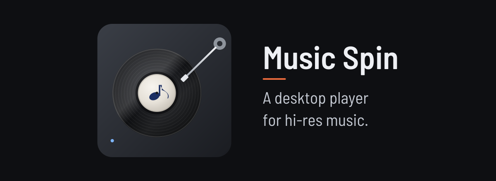
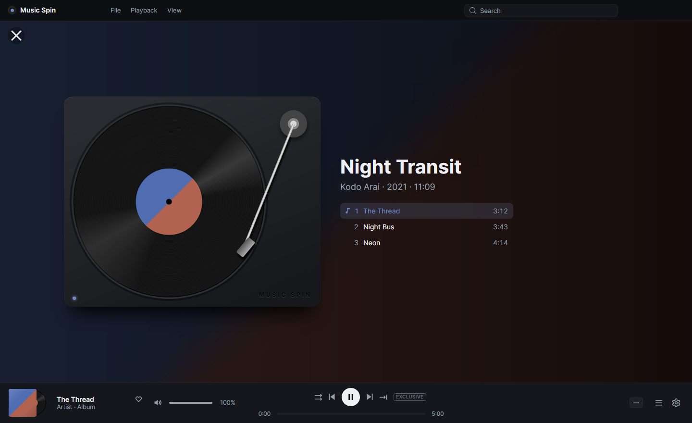
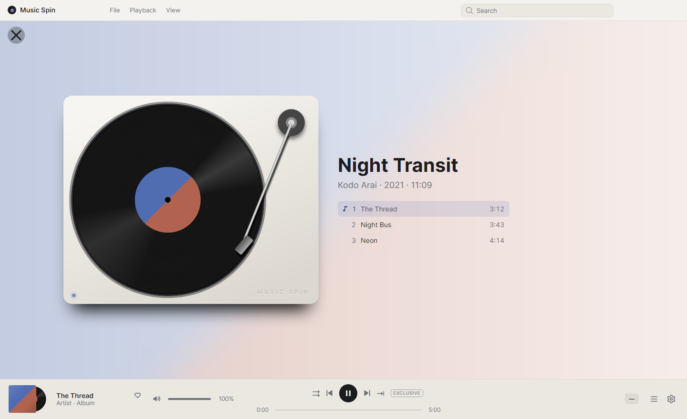
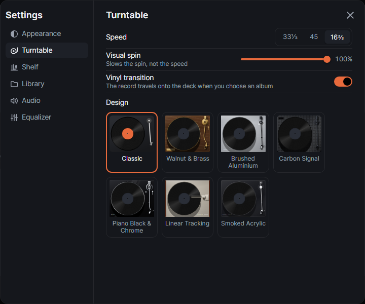
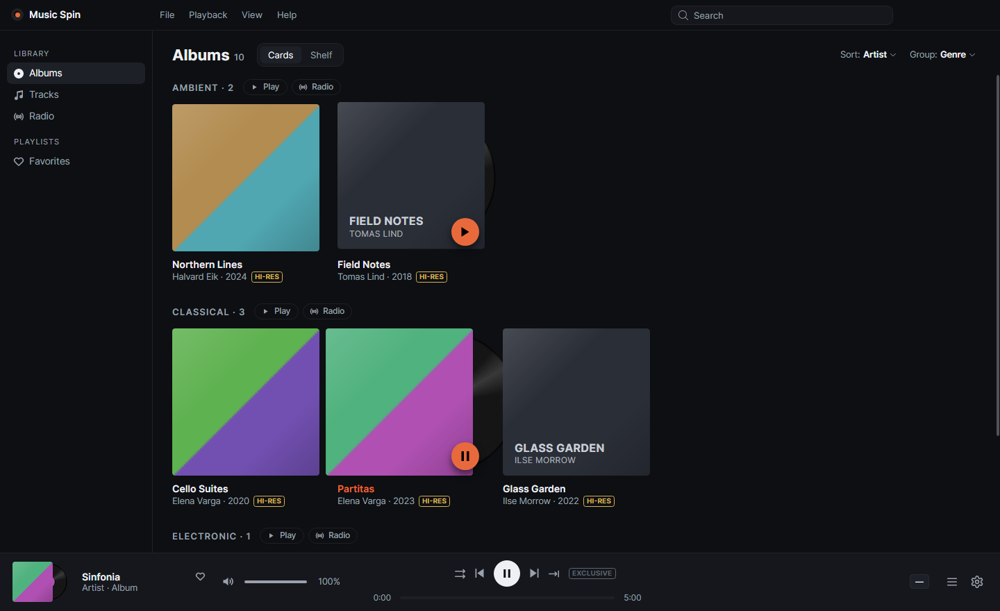
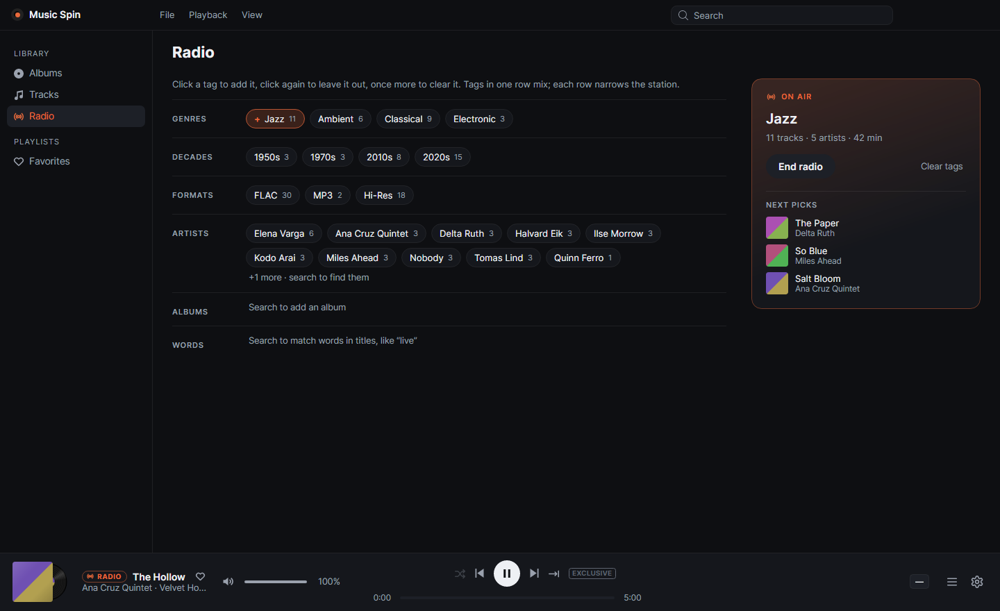

# Music Spin

[](https://github.com/vgabi94/MusicSpin/actions/workflows/ci.yml)
[](https://github.com/vgabi94/MusicSpin/releases)
[](#license)
[](#download-and-install)



**Music Spin** is a free, open-source, portable desktop and command-line music player for local hi-res audio libraries on Windows, macOS, and Linux.

It plays your files straight from your existing folders without ever modifying them, pairs a turntable-inspired desktop UI with a full CLI (`music-spin`) and built-in [MCP](https://modelcontextprotocol.io) server for AI agents, and runs everything through one shared background player and queue.

[Features](#features) · [Download and Install](#download-and-install) · [Build from Source](#build-from-source) · [Command Line and AI Agents](#command-line-and-ai-agents) · [Documentation](#documentation) · [License](#license)

<table>
  <tr>
    <td width="50%"></td>
    <td width="50%"></td>
  </tr>
</table>

---

## Features

### Audio & Playback

- **Hi-res & broad format support (FFmpeg 9.0):** Plays lossless formats (`FLAC`, `ALAC`, `WAV`/`W64`/`RF64`, `AIFF`, `DSD` `.dsf`/`.dff` decoded to PCM, `WavPack`, `APE`, `TTA`, `MLP`/`TrueHD`) and lossy formats (`MP3`, `AAC`, `Ogg Vorbis`, `Opus`, `WMA`, `Musepack`).
- **Bit-perfect & exclusive output:** Opens your audio device at the track's native sample rate and bit depth (`16-bit`, `24-bit`, or `32-bit float`) in exclusive mode (`WASAPI` on Windows, `CoreAudio` on macOS, `ALSA` on Linux). In shared mode, tracks are resampled once with `libsamplerate`'s highest-quality sinc converter when rates differ.
- **Gapless playback:** Consecutive tracks with matching format transition without gaps, including lossy formats with encoder padding removed.
- **Volume levelling (ReplayGain / EBU R128):** Off by default to keep audio untouched. Supports `auto` (album gain for albums in order, track gain for shuffle/radio), `track`, and `album` modes, reads existing tags or measures untagged tracks in the background, and prevents clipping (capped at +6 dB boost).
- **10-band graphic equalizer:** Off by default. ISO octave bands (31.25 Hz–16 kHz), 11 built-in presets plus up to 64 custom presets, smooth cross-fades, automatic clipping headroom, and bit-exact bypass when off or flat.

### Desktop App & Turntable Experience

- **Turntable Now Playing view:** Choose from 7 deck designs (*Classic*, *Walnut & Brass*, *Brushed Aluminium*, *Carbon Signal*, *Piano Black & Chrome*, *Linear Tracking*, *Smoked Acrylic*), animated vinyl-to-platter transitions, selectable speeds (`16⅔`, `33⅓`, `45` RPM), and adjustable visual spin scaling without changing playback speed.
- **Light & dark themes with dynamic accents:** Automatically derives contrast-checked accent colors from the playing album's cover art.
- **Player bar & live visualizer:** Scrub bar, volume slider (percentage or decibel scale), active output/format badges, and a real-time 16-band spectrum analyzer.
- **Native OS integration:** Media keys and system Now Playing controls on Windows (SMTC and taskbar thumbnail buttons), macOS (Now Playing), and Linux (MPRIS), plus a system tray icon while playing.

<p align="center">
  
</p>

### Library, Playlists & Radio

- **Read-only local library:** Indexes your folders into a local database without ever moving files or editing tags. Supports fast incremental rescans, optional live folder watching, fingerprint-based rename/move tracking, and instant `library relocate` when a drive or root folder moves.
- **Flexible browsing & search:** Browse albums as **Cards** or a **3D Shelf** (adjustable tilt and depth) or view all **Tracks**, sorting by artist, title, or year and grouping by artist, album, or genre. Search is case- and diacritic-insensitive and supports quoted phrases and field filters (`artist:`, `album:`, `title:`, `genre:`, `year:`, `is:favorite`).
- **Queue, playlists & favorites:** Slide-out queue drawer with drag-and-drop reordering, *Play next* / *Add to queue*, automatic queue persistence across restarts (restored paused), saved playlists with `M3U`/`M3U8`/`PLS` import and export, and a **Favorites** view.
- **Endless Radio:** Build random stations from any combination of included or excluded genres, artists, albums, decades/years, formats, hi-res tracks, favorites, or search terms — with repeat avoidance, artist/album spacing, optional *favorites first* weighting, and recent/saved stations.

<table>
  <tr>
    <td width="50%"></td>
    <td width="50%"></td>
  </tr>
</table>

### Shared Player, CLI & AI Agents

- **One player across every interface:** The desktop app (`MusicSpin`), the CLI (`music-spin`), and the MCP server (`music-spin mcp`) all control the same detached background player, library, and queue. Start an album from a terminal or AI agent, then skip or adjust the equalizer in the window.
- **Automation-friendly:** Add `--json` to any CLI command for single-line JSON output with stable error codes, or embed the player directly with `music-spin serve`.

### Portable & Private

- **Portable by default:** All app data (settings, library database, cover cache, queue, logs) lives in `.usrdata/` next to the executables. Nothing is written to the Windows Registry, `%APPDATA%`, `~/.config`, or `~/Library`. Override the location anytime with `--data-dir` or `MUSICSPIN_DATA_DIR`.
- **Offline & local-only:** No accounts, no telemetry, and no network listeners. IPC uses a local user-only Unix domain socket (Linux/macOS) or named pipe (Windows).

---

## Download and Install

Prebuilt portable `.tar.gz` archives are available on the **[GitHub Releases](https://github.com/vgabi94/MusicSpin/releases)** page:

| Platform | Architectures | Included & Runtime Requirements |
| --- | --- | --- |
| **Windows** | `win-x64`, `win-arm64` | Self-contained (`MusicSpin.exe`, `music-spin.exe`) with **FFmpeg 9.0** bundled |
| **Linux** | `linux-x64`, `linux-arm64` | Self-contained (`MusicSpin`, `music-spin`, `MusicSpin.png`) with **FFmpeg 9.0** bundled; requires system `libicu` (standard on desktop distros) |
| **macOS** | `osx-x64`, `osx-arm64` | Self-contained (`MusicSpin.app`, `music-spin`); install FFmpeg 9 separately via `brew install ffmpeg` |

### Quick setup

1. Download the `.tar.gz` archive for your OS and architecture and unpack it into any writable folder (for example `~/Apps/MusicSpin` or `C:\Tools\MusicSpin`).
2. **macOS only:** Install FFmpeg 9 (`brew install ffmpeg`). Because releases are not yet signed or notarized, move `MusicSpin.app` out of `Downloads` or run `xattr -dr com.apple.quarantine MusicSpin.app` if macOS blocks launching or writing `.usrdata/`.
3. Launch `MusicSpin` (or `MusicSpin.app`) and select a music folder, or check your environment in a terminal with `music-spin doctor`.

> **Portable layout:** Copy or move the unpacked folder to bring your library, playlists, and settings (`.usrdata/`) along with it. On macOS, `.usrdata/` sits next to `MusicSpin.app`. `TagLibSharp.dll` and `ffmpeg/` remain separate files beside the executables so you can swap in your own compatible LGPL builds. See [Getting started](docs/getting-started.md) for details.

---

## Build from Source

### Prerequisites

- **[.NET 10 SDK](https://dotnet.microsoft.com/download)** (`global.json` pins `10.0.100` with `rollForward: latestFeature`).
- **A C compiler** (MSBuild automatically compiles the native `msaudio` audio layer during build and publish):
  - **Windows:** Visual Studio or [Visual Studio Build Tools](https://visualstudio.microsoft.com/downloads/) with the **Desktop development with C++** workload.
  - **Linux:** `cc` / GCC (no ALSA or PulseAudio dev headers needed; for cross-building `linux-arm64`, install `gcc-aarch64-linux-gnu`).
  - **macOS:** Xcode Command Line Tools (`xcode-select --install`).
- **FFmpeg 9.0 shared libraries** (downloaded automatically by the publish scripts on Windows/Linux, or installed via the helper scripts below; on macOS use `brew install ffmpeg`).

### Build a portable release folder (recommended)

**Linux / macOS:**

```bash
git clone https://github.com/vgabi94/MusicSpin.git
cd MusicSpin
./eng/publish.sh --download-ffmpeg
```

**Windows (PowerShell):**

```powershell
git clone https://github.com/vgabi94/MusicSpin.git
cd MusicSpin
./eng/publish.ps1 -DownloadFFmpeg
```

This creates a ready-to-run portable folder in `artifacts/publish/<rid>/` containing `MusicSpin` (`MusicSpin.app` on macOS), `music-spin`, `TagLibSharp.dll`, `ffmpeg/` (on Windows and Linux), and the license files. On macOS, run `brew install ffmpeg` so FFmpeg 9 is available at runtime.

### Build, run, and test during development

1. **Install FFmpeg 9.0 shared libraries once:**

   ```bash
   # Linux / macOS
   ./eng/get-ffmpeg.sh
   ```

   ```powershell
   # Windows (PowerShell)
   ./eng/get-ffmpeg.ps1
   ```

2. **Build and run the test suite:**

   ```bash
   dotnet build MusicSpin.slnx
   dotnet test --solution MusicSpin.slnx
   ```

3. **Run the CLI or desktop app from the checkout:**

   ```bash
   # CLI
   dotnet run --project src/MusicSpin.Cli -- doctor

   # Desktop app (Linux / macOS — point MUSICSPIN_CLI at the built CLI executable)
   MUSICSPIN_CLI="$PWD/src/MusicSpin.Cli/bin/Debug/net10.0/music-spin" \
     dotnet run --project src/MusicSpin.App
   ```

   ```powershell
   # Desktop app (Windows PowerShell)
   $env:MUSICSPIN_CLI = "$PWD\src\MusicSpin.Cli\bin\Debug\net10.0\music-spin.exe"
   dotnet run --project src/MusicSpin.App
   ```

See [Building, testing and publishing](docs/building.md) for cross-compilation options, test filters, code coverage, and performance markers.

---

## Command Line and AI Agents

### Terminal usage

```bash
music-spin doctor
music-spin library add ~/Music
music-spin library scan
music-spin play --album "Kind of Blue"
music-spin status
music-spin next
music-spin radio --genre jazz --years 1955-1969
music-spin quit
```

- `play` and `radio` start the detached background player and return immediately; playback continues even after you close the terminal (`music-spin quit` stops it).
- Add `--json` to any command for compact, single-line JSON output (including structured errors).
- Closing the desktop window stops a player that the app started, or pauses a player started from the CLI (`music-spin resume` continues from where it left off).

### Connect an AI agent (MCP)

`music-spin mcp` exposes the library, playlists, favorites, radio, equalizer, volume levelling, and playback controls over standard stdio MCP — compatible with **Claude Desktop**, **Claude Code**, **Cursor**, **Grok CLI**, and other MCP clients.

For example, with Claude Code:

```bash
claude mcp add musicspin -- /path/to/music-spin mcp
```

Full client configurations and the tool reference are in [MCP server](docs/mcp.md). For scripting with shell JSON or the `serve` JSON-lines protocol, see [AI agents](docs/ai-agents.md).

---

## Documentation

| Document | Contents |
| --- | --- |
| [Getting started](docs/getting-started.md) | Portable folder layout, `.usrdata`, `settings.json`, FFmpeg discovery |
| [Playback](docs/playback.md) | Formats, bit-perfect & exclusive output, DSD, gapless, volume levelling, equalizer, radio |
| [Music library](docs/library.md) | Scanning, change & move detection, `library relocate`, search syntax, cover art, playlists, favorites |
| [CLI reference](docs/cli-reference.md) | Every `music-spin` command, option, JSON envelope, and exit code |
| [MCP server](docs/mcp.md) | Client configuration (Claude Desktop, Claude Code, Cursor, Grok CLI) and MCP tools |
| [AI agents](docs/ai-agents.md) | JSON conventions, background-player workflow, `serve` JSON-lines protocol |
| [Diagnostics](docs/diagnostics.md) | `doctor`, `devices`, logs, performance overlays, common problems & fixes |
| [Building](docs/building.md) | Build, test, publish scripts, code coverage, CI and release workflows |
| [Architecture](docs/architecture.md) | Solution structure, audio pipeline, IPC design, desktop app internals |
| [Licensing](docs/licensing.md) | GPL-3.0-or-later, Svg.Custom exception, LGPL compliance for FFmpeg and TagLib# |

---

## Troubleshooting and Contributing

- **Check your setup:** Run `music-spin doctor` to verify FFmpeg 9.0, audio devices, and `.usrdata` permissions, and `music-spin devices` to inspect available outputs.
- **Logs:** Background player logs are written to `.usrdata/player.log`, and desktop app errors/crashes to `.usrdata/app.log`.
- **Common fixes:** See [Diagnostics → Common problems](docs/diagnostics.md#common-problems).
- **Bugs & contributions:** Open an issue or pull request on [GitHub](https://github.com/vgabi94/MusicSpin/issues). Contributions are accepted under the project's license below.

---

## License

Music Spin is licensed under the **GNU General Public License v3.0 or later** (`GPL-3.0-or-later`), with an additional permission under GPLv3 section 7 allowing combination with `Svg.Custom` / `SVG.NET` (MS-PL). FFmpeg and `TagLibSharp.dll` are kept separate outside the single-file binaries for LGPL replaceability.

- [LICENSE](LICENSE) — GNU GPL v3 text
- [LICENSE-EXCEPTION.txt](LICENSE-EXCEPTION.txt) — Copyright notice and GPLv3 section 7 additional permission
- [THIRD-PARTY-NOTICES.md](THIRD-PARTY-NOTICES.md) — Bundled and dynamically loaded third-party components
- [docs/licensing.md](docs/licensing.md) — Licensing and redistribution checklist
<!--
  Screenshots are renders of the current app, copied from
  tests/MusicSpin.Tests.Ui/Snapshots. The header icon is the inner markup of
  src/MusicSpin.App/Assets/AppIcon/app-icon.svg, copied verbatim.
-->
