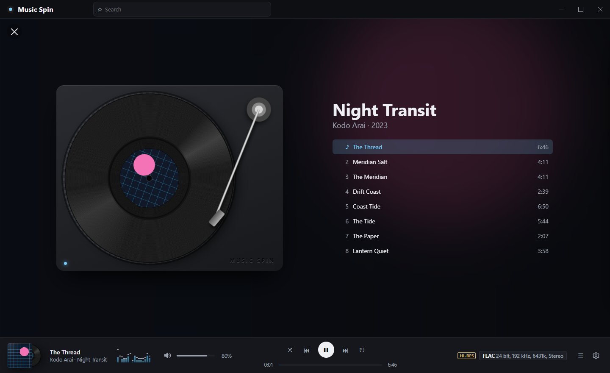

# MusicSpin

An open-source (MIT), cross-platform **desktop music player for hi-res audio**, with a CLI (`music-spin`) that people and AI agents can both script.

> **Work in progress.** The CLI, the background player and the library work today. The desktop app is being built from the design below, a mockup you can open in a browser ([UI design](docs/design/README.md)). Progress is tracked in the [`area: app` issues](https://github.com/vgabi94/MusicSpin/issues?q=label%3A%22area%3A+app%22).



## Features

- **Plays almost any format**, decoded by [FFmpeg](https://ffmpeg.org) 9.0: FLAC, ALAC, WAV/W64/RF64, AIFF, DSD (DSF/DFF, played as PCM), WavPack, APE, TTA, MP3, AAC, Vorbis, Opus and more.
- **Aims for bit-perfect output:** no resampling, a device format matching the source bit depth, untouched samples at volume 1.0, and optional exclusive mode (WASAPI exclusive, ALSA hw, CoreAudio) through [SoundFlow](https://github.com/LSXPrime/SoundFlow)/[miniaudio](https://miniaud.io).
- **Music library:** LiteDB database, TagLib# tags with FFmpeg fallback, fast parallel incremental scanning, album grouping including compilations/Various Artists, ranked case- and diacritic-insensitive search (per-word, phrases, `artist:`/`album:`/`title:`/`genre:`/`year:`), per-field filters, quality filters (hi-res, sample rate, bit depth, format, year), stable GUID track ids (UUIDv7, independent of the path), rename/move detection by content fingerprint (id, date added, playlist and queue entries follow), `library relocate` for moved folders or remounted drives, health check, folder watching.
- **Background player:** `music-spin play` returns at once. Quick commands (`pause`, `next`, `seek`, `volume`, `status`, `queue`, ...) control it. Playback survives the terminal or agent that started it.
- **Playlists:** saved in the library (case-insensitive unique names, entries keep track id + path, missing files kept and flagged), M3U/M3U8/PLS import (encodings, relative/Windows/`file://` paths) and export, `play --playlist`, `queue save`. The player's queue persists across restarts (restored paused).
- **Favorites:** heart library tracks (`favorite add`, `--current` for the one playing), list them newest first (`favorites`), filter with `tracks --favorites`, play them (`play --favorites`) or run a favorites radio. Favorites follow their tracks through rescans, moves and `library relocate`.
- **Radio:** `music-spin radio` plays the whole library (or the part you filter by artist, album, genre, year/range, format, hi-res or search, minus anything you `--exclude-*`) endlessly in random order. No track repeats within the last 100, the same artist or album is not played twice in a row when there is a choice, `prev` goes back through what played, gapless between same-format tracks, and the station survives a player restart. See [Playback → Radio](docs/playback.md#radio).
- **Repeat and shuffle:** repeat off/one/all and a shuffle toggle on the running queue (the current track keeps playing; `off` restores the original order; reproducible with `--seed`), saved as defaults.
- **Agent-friendly:** `--json` on every command (one JSON object per line, errors included), stable exit codes, an **MCP server** (`music-spin mcp`), and a JSON-lines `serve` mode.
- **Portable:** one self-contained executable per platform. All data lives in the [data folder](docs/getting-started.md#data-folder): by default `.usrdata/` next to it. `--data-dir` or `MUSICSPIN_DATA_DIR` can point it elsewhere (optional).

## Status

**v0.1, pre-UI.** Core playback, the library, the background player, the CLI, the MCP server, portable publishing and the tests (about 1,500) work. The UI design is decided ([mockup](docs/design/README.md)); the desktop app has its shell (title bar, sidebar, themes), the Albums page as Cards and the Tracks page (both sorted, grouped and searched as in the mockup), the playlist and Radio pages, the player bar (transport, position, volume, spectrum analyzer, format) and Settings, and follows the background player; the rest is being built.

| Platform | Status |
|---|---|
| Linux x64 | Verified: build, full test suite, published single-file build, background player, MCP over stdio |
| Windows x64 | CI (`windows-latest`): build and the full test suite, including the end-to-end background player tests (named pipe, detached spawn, MCP over stdio). Real audio output and the published build are **not verified yet** |
| macOS | CI (`macos-latest`, arm64): build and the full test suite, including the end-to-end background player tests. Real audio output and the `.app` bundle are **not verified yet** |

Gapless playback between same-format tracks is supported. Not available yet: native DSD/DoP output. See the [Roadmap](#roadmap).

## Quick start

There are no published releases yet. Build a portable folder with `./eng/publish.sh` (see [Building](docs/building.md)), then:

```console
$ ./music-spin doctor                  # FFmpeg, audio output, data folder
$ ./music-spin library add ~/Music
$ ./music-spin library scan
$ ./music-spin albums
$ ./music-spin play --album "Spaces"   # starts the background player and returns
$ ./music-spin status
$ ./music-spin next
$ ./music-spin quit
```

MusicSpin needs the **FFmpeg 9.0 shared libraries**. Release builds ship them in `ffmpeg/`; for development, run `./eng/get-ffmpeg.sh` (or `.ps1`). Details: [Getting started](docs/getting-started.md).

## CLI examples

```console
$ music-spin info "02 Says.flac"
/home/me/Music/Nils Frahm/Spaces/02 Says.flac
  FLAC · 24-bit / 96 kHz · 2 ch (stereo) · 4:00 · hi-res
  ...

$ music-spin search rani                         # artists, albums and tracks matching "rani", best first
$ music-spin tracks --artist "Hania Rani"        # exact artist name, case-insensitive
$ music-spin filter --hires --min-sample-rate 96000 --format flac,dsd
$ music-spin play --artist "Nils Frahm" --shuffle --seed 7
$ music-spin queue add --search "glass"
$ music-spin seek 1:30 && music-spin volume 80%
$ music-spin repeat all && music-spin shuffle on
$ music-spin radio --genre jazz --years 1955-1965   # endless random jazz from those years
$ music-spin radio --exclude-genre Christmas --exclude-artist "Kenny G"   # whole library minus those
$ music-spin favorite add --current               # heart the track that is playing
$ music-spin favorites                             # newest favorites first
$ music-spin radio --favorites --genre jazz        # endless random favorite jazz

$ music-spin status --json
{"ok":true,"command":"status","data":{"state":"playing","positionSeconds":1.78,"durationSeconds":240,"volume":1,"track":{"codec":"flac","sampleRate":96000,"bitsPerSample":24,"lossless":true,"hiRes":true,"title":"An Aborted Beginning",...},"queueIndex":0,"queueLength":3,...}}

$ music-spin next --json; echo $?
{"ok":false,"command":"next","error":{"code":"invalid_state","exitCode":8,"message":"Already at the last track (3 of 3). Add more with 'music-spin queue add', or use 'music-spin repeat all'."}}
8
```

Every command and option, with the exit code table, is in the [CLI reference](docs/cli-reference.md).

### MCP

```json
{
  "mcpServers": {
    "musicspin": { "command": "/opt/MusicSpin/music-spin", "args": ["mcp"] }
  }
}
```

40 tools (`play`, `pause`, `next`, `seek`, `volume`, `status`, `queue_add`, `repeat`, `shuffle`, `search`, `tracks`, `albums`, `favorite_add`, `favorites`, `playlist_*`, `library_relocate`, ...) drive the same background player and library as the CLI. Setup for Claude Desktop, Cursor, Claude Code and Grok CLI: [MCP server](docs/mcp.md).

## Build and test

Requirements: the [.NET 10 SDK](https://dotnet.microsoft.com/download), and FFmpeg 9.0 for playback and the FFmpeg-backed tests.

```bash
./eng/get-ffmpeg.sh                    # Linux/macOS (Windows: ./eng/get-ffmpeg.ps1)
dotnet build MusicSpin.slnx
dotnet test --solution MusicSpin.slnx  # xUnit v3 on Microsoft.Testing.Platform
dotnet run --project src/MusicSpin.Cli -- doctor
./eng/publish.sh linux-x64 --download-ffmpeg   # portable folder in artifacts/publish/linux-x64/
```

Projects: `MusicSpin.Core` (engine, no UI), `MusicSpin.App` (Avalonia, `MusicSpin`), `MusicSpin.Cli` (`music-spin`), and the tests `MusicSpin.Tests`, `MusicSpin.Tests.Cli`, `MusicSpin.Tests.Ui`. See [Architecture](docs/architecture.md) and [Building](docs/building.md).

## Documentation

| | |
|---|---|
| [Getting started](docs/getting-started.md) | portable layout, the data folder (`.usrdata`), FFmpeg, first commands |
| [CLI reference](docs/cli-reference.md) | every command and option, `--json`, exit codes |
| [Music library](docs/library.md) | scanning, change detection, renames/moves and relocate, stored metadata, search/filter semantics |
| [Playback](docs/playback.md) | formats, bit-perfect/exclusive mode, DSD, background player, queue, repeat and shuffle |
| [AI agents](docs/ai-agents.md) | JSON conventions, background-player workflow, `serve` protocol |
| [MCP server](docs/mcp.md) | transport, client configuration, tools, errors |
| [Diagnostics](docs/diagnostics.md) | `doctor`, `devices`, logs, common problems |
| [Architecture](docs/architecture.md) | projects, layering, audio pipeline, IPC |
| [Building](docs/building.md) | build, test, publish, trimming, CI/release |
| [Licensing](docs/licensing.md) | MIT and the LGPL obligations (FFmpeg, TagLib#) |

## Roadmap

- [x] Playback core, library, portable single-file publishing, background player, CLI with `--json`, MCP server
- [x] Verify the background player on Windows and macOS, and enable the end-to-end tests there (CI)
- [ ] Verify real audio output and the published builds on Windows and macOS
- [x] Desktop UI design: an HTML mockup in [docs/design](docs/design/README.md)
- [ ] Desktop UI, built from the mockup. The app attaches to the background player (`PlayerClient` + `subscribe`)
- [x] Repeat one/all and a shuffle toggle
- [x] Saved playlists, M3U/M3U8/PLS import/export, persistent queue
- [x] Ranked, diacritic-insensitive search with field syntax and per-field filters
- [x] Rename/move detection (fingerprints) and `library relocate`
- [x] Path-independent GUID track ids
- [x] Gapless playback; decoding on a separate thread into a ring buffer
- [ ] Native DSD/DoP output; bit-perfect verification on real hardware (WASAPI exclusive, ALSA `hw:`, CoreAudio)
- [ ] Audio-only LGPL FFmpeg build (~120 MB → a few MB), LGPL FFmpeg for macOS, signing/notarization, GitHub releases
- [ ] Trimming (System.Text.Json source generation), a `dotnet tool` package for the CLI
- [x] Album art extraction and caching in the data folder (used by the desktop app)
- [x] Radio: endless random playback of the library with filters

### Later

Deferred radio options:

- `radio --seed <n>` for a reproducible station
- Saved stations (`radio save <name>`, `radio list`, `radio <name>`)
- Weighting toward tracks not heard recently, once play counts exist
- `--exclude-*` options for `play`, `tracks` and `filter` too (radio has them; the listings share another query path, so this is a separate change)

## License

MusicSpin is MIT-licensed: Copyright (c) 2026 Gabriel Vaduva, see [LICENSE](LICENSE). Third-party components keep their own licenses: FFmpeg (LGPL, loaded dynamically from `ffmpeg/`) and TagLib# (LGPL-2.1, separate `TagLibSharp.dll`) stay replaceable. The rest is MIT/Apache-2.0/public domain. See [THIRD-PARTY-NOTICES.md](THIRD-PARTY-NOTICES.md) and [Licensing](docs/licensing.md).
