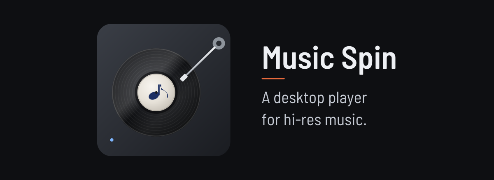
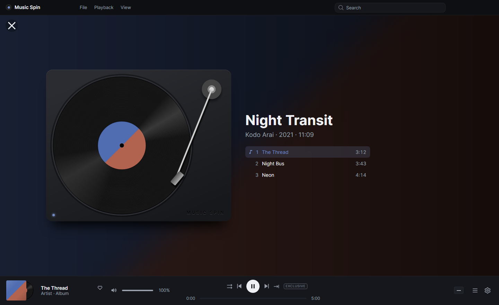
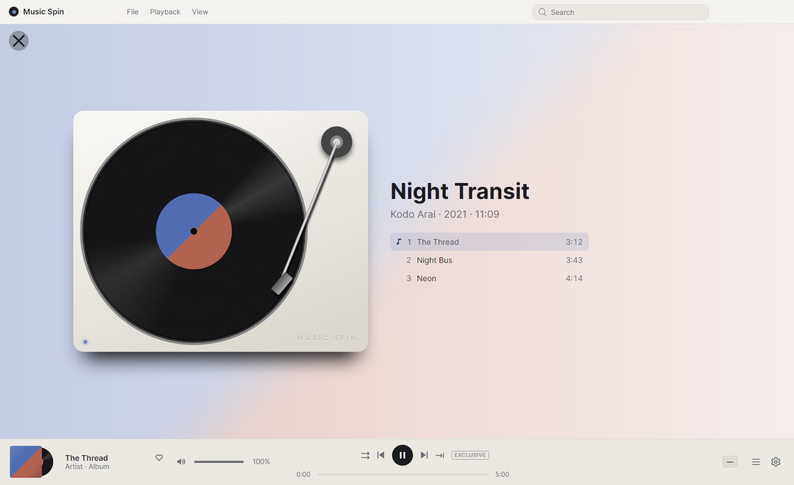
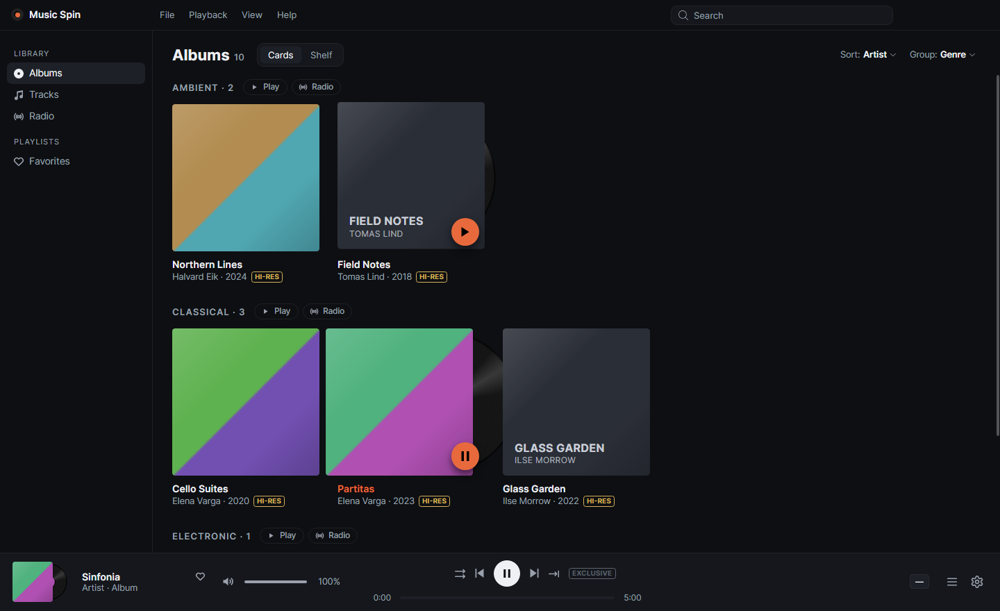
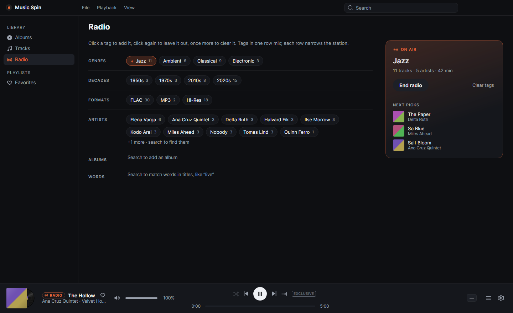
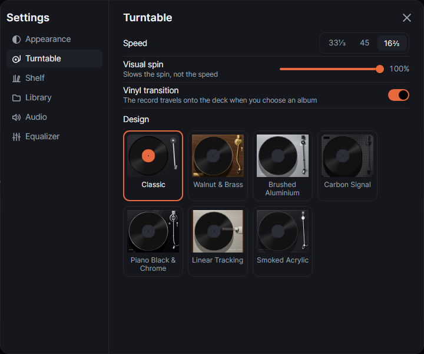

# Music Spin

[](https://github.com/vgabi94/MusicSpin/actions/workflows/ci.yml)
[](#license)
[](#install)



Music Spin plays a hi-res library that stays on your computer. Albums show up as cards or on a shelf, and Now Playing sets the record on a turntable. You can queue what is next, or let radio keep going through a part of the library.

`music-spin` drives that same player from a terminal, and an assistant can too.

These pictures are the app, with an example library.

<table>
  <tr>
    <td width="50%"></td>
    <td width="50%"></td>
  </tr>
</table>

<table>
  <tr>
    <td width="50%"></td>
    <td width="50%"></td>
  </tr>
</table>



A renamed or moved file stays the same track, so playlists and the queue follow it. [Library](docs/library.md). Formats and the output device are in [Playback](docs/playback.md).

## From a terminal

```console
$ music-spin library add ~/Music
$ music-spin play --album "Album title"
```

The command returns, and the music keeps playing. Commands are in the [CLI reference](docs/cli-reference.md). Assistant setup is in [MCP](docs/mcp.md).

## Install

No release is published yet. With the [.NET 10 SDK](https://dotnet.microsoft.com/download):

```bash
git clone https://github.com/vgabi94/MusicSpin.git
cd MusicSpin
./eng/publish.sh --download-ffmpeg
```

```powershell
./eng/publish.ps1 -DownloadFFmpeg
```

Copy `artifacts/publish/<rid>/` where you like. Settings and the library stay in that folder. [Getting started](docs/getting-started.md). [Building](docs/building.md).

## License

GPL-3.0-or-later. [LICENSE](LICENSE). [LICENSE-EXCEPTION.txt](LICENSE-EXCEPTION.txt).
<!--
  Screenshots are headless renders of the current app, copied from
  tests/MusicSpin.Tests.Ui/Snapshots. The header icon is the inner markup of
  src/MusicSpin.App/Assets/AppIcon/app-icon.svg, copied verbatim.
-->
