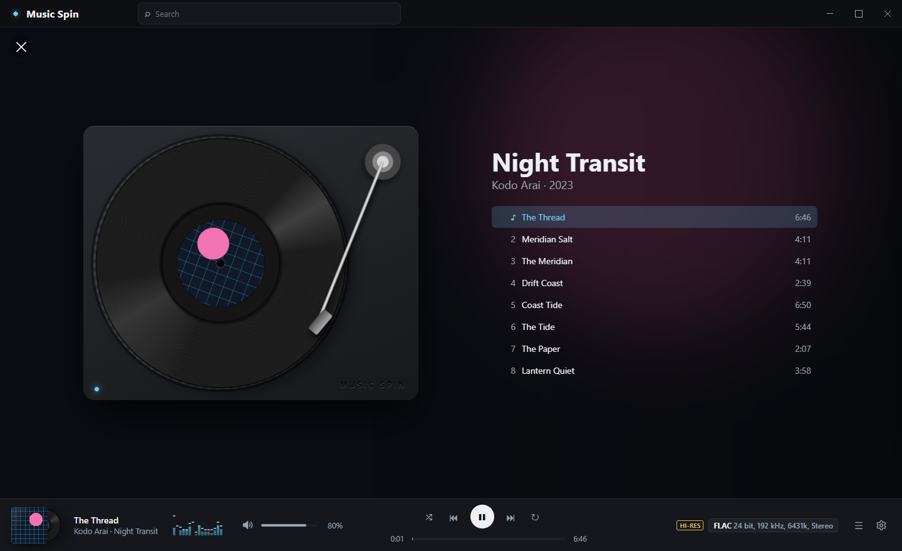

# Music Spin

A desktop music player for people who care how their music sounds, and a command line that people and AI agents can
both script. It's free, open source (MIT) and runs on Windows, macOS and Linux.

> **Work in progress.** The CLI, the background player and the library work today. The desktop app is being built from the design below, a mockup you can open in a browser ([UI design](docs/design/README.md)). Progress is tracked in the [`area: app` issues](https://github.com/vgabi94/MusicSpin/issues?q=label%3A%22area%3A+app%22).



## What it is

Music Spin is for a hi-res library you want played as it is: no silent resampling, no guessing what reaches the DAC,
and a library that keeps up when files get renamed or moved. It's also for driving your music from a terminal or an
AI assistant without fighting a GUI. So it is two things that share one engine:

- **a desktop app** with an album-first library and a turntable that spins while the record plays, and
- **`music-spin`**, a command line (and an MCP server) that controls the same player and reads the same library.

The music plays in a small background player. The app, the CLI and your AI agent are remote controls for it, so you
can start an album from the terminal, skip a track in the app and ask your assistant what's playing, and all three
agree.

## Features

### Sound

- **Plays almost anything**, decoded by [FFmpeg](https://ffmpeg.org) 9.0: FLAC, ALAC, WAV/W64/RF64, AIFF, DSD
  (DSF/DFF, played as PCM), WavPack, APE, TTA, MP3, AAC, Vorbis, Opus and more.
- **Bit-perfect where it can be.** No resampling, a device format that matches the source's bit depth, and samples left
  untouched at full volume. Exclusive mode (WASAPI exclusive, ALSA `hw:`, CoreAudio) bypasses the system mixer, and
  the format the device actually opened is shown, so you can check.
- **Gapless** between tracks of the same format.
- **Volume levelling** from ReplayGain / R128 tags, or from a background EBU R128 analysis of untagged files: track,
  album or automatic, never clipping, and bit-exact when you turn it off.
- **A graphic equalizer**, off until you want it.

### The desktop app

- **Albums three ways:** as cards, standing on a shelf, or flipped through in record crates, sorted by
  artist, title or year and grouped by artist or genre.
- **Tracks** in one long sortable list, grouped as you like, with instant search.
- **Now Playing** puts the album on a turntable. There are seven decks to choose from (Classic, Walnut & Brass,
  Brushed Aluminium, Carbon Signal, Piano Black & Chrome, Linear Tracking, Smoked Acrylic), and an album you pick
  travels from the page onto the platter before it plays.
- **A player bar** with the transport, a scrub bar, the volume, a spectrum analyzer and the file's format at a glance.
- **The queue** in a drawer: drag albums and tracks into it, reorder them, save it as a playlist.
- **Playlists and favorites** in the sidebar; drag anything onto them.
- **Radio:** build a station from genres, artists, years and formats, and it plays your library endlessly in random
  order without repeating itself.
- **At home on your desktop:** media keys and the system's media controls (Windows, macOS Now Playing, MPRIS on
  Linux), a tray icon, light and dark themes, and an accent colour taken from the album that's playing.

### The library

- Point it at your music folders and it scans them, quickly and incrementally, and keeps watching them for changes.
- Tags come from TagLib#, with FFmpeg as a fallback. Compilations and Various Artists albums group properly.
- Search is ranked, ignores case and accents, and understands `artist:`, `album:`, `title:`, `genre:` and `year:`.
  Filter by quality too: hi-res, sample rate, bit depth, format.
- **Renaming or moving files loses nothing.** Tracks are recognised by their content, so playlists, favorites and the
  queue follow them. Moved a whole drive? `library relocate` points the library at the new place.

### Scripting and AI agents

- Every command takes `--json` and answers with one JSON object per line, errors included, with stable exit codes.
- `music-spin mcp` is an **MCP server** with 41 tools, so Claude, Cursor, Grok and other MCP clients can play music,
  search the library and manage playlists.
- `music-spin serve` speaks a JSON-lines protocol for your own tools.

### Portable

One self-contained executable per platform, and nothing written outside its folder: the settings, the library and the
player's files live in a `.usrdata` folder next to it. Copy the folder to another machine or a USB stick and your
library comes along. ([Data folder](docs/getting-started.md#data-folder))

## Install

There are no published releases yet. For now you build a portable folder yourself, which takes a few minutes.

1. Install the [.NET 10 SDK](https://dotnet.microsoft.com/download).
2. Clone the repository and publish for your machine, downloading an LGPL FFmpeg build along the way:

   ```bash
   git clone https://github.com/vgabi94/MusicSpin.git
   cd MusicSpin
   ./eng/publish.sh --download-ffmpeg            # Linux and macOS
   ```

   ```powershell
   ./eng/publish.ps1 -DownloadFFmpeg             # Windows
   ```

3. Copy `artifacts/publish/<platform>/` wherever you like (`~/Apps`, `D:\Tools`, a USB stick). It holds `MusicSpin`
   (the app), `music-spin` (the CLI), the FFmpeg libraries and the license files.

Linux also needs the system ICU library (`libicu`), which every desktop distribution ships. Builds for other platforms,
zips and the other options are in [Building](docs/building.md#publishing-self-contained-single-file).

### Platform status

| Platform | Status |
|---|---|
| Linux x64 | Verified: build, the full test suite, the published build, the background player, MCP over stdio |
| Windows x64 | Built and tested on CI, including the background player end to end. Real audio output and the published build are **not verified yet** |
| macOS (arm64) | Built and tested on CI, including the background player end to end. Real audio output and the `.app` bundle are **not verified yet** |

## Using the app

Start `MusicSpin`. The first time, the library is empty: click **Add a music folder**, pick where your music lives,
and the albums appear as the scan finds them. You can add more folders, rescan or remove them later in
**Settings › Library**.

- Click an album to play it; it lands on the turntable in **Now Playing**. Right-click an album or a track to play it
  next, or add it to the queue or a playlist.
- Switch between **Cards**, **Shelf** and **Crate** at the top of the Albums page, and change the sorting and grouping
  beside them.
- Open the queue with the ☰ button in the player bar, and drag albums and tracks into it.
- On the **Radio** page, pick what the station should play and press **Start radio**.
- **Settings** (the cog, or Ctrl+,) has the theme, motion, the turntable design, the library folders, the output
  device and exclusive mode, volume levelling and the equalizer.

The app doesn't play the music itself: it connects to the background player and starts one if none is running.
Closing the app stops the music.

| Shortcut | Does |
|---|---|
| Space | Play or pause |
| Ctrl+← / Ctrl+→ | Back or forward 5 seconds |
| Ctrl+↑ / Ctrl+↓ | Volume up or down |
| Ctrl+F | Search |
| Ctrl+, | Settings |
| Esc | Close whatever is open on top |
| Ctrl+Q | Quit |

On macOS, use ⌘ instead of Ctrl for search, Settings and quit.

## Using the command line

```console
$ ./music-spin doctor                  # checks FFmpeg, the audio output and the data folder
$ ./music-spin library add ~/Music
$ ./music-spin library scan
$ ./music-spin albums
$ ./music-spin play --album "Spaces"   # starts the background player and returns
$ ./music-spin status
$ ./music-spin next
$ ./music-spin quit
```

`play` returns at once, and the music keeps going after the terminal closes. A few more things it can do:

```console
$ music-spin info "02 Says.flac"
/home/me/Music/Nils Frahm/Spaces/02 Says.flac
  FLAC · 24-bit / 96 kHz · 2 ch (stereo) · 4:00 · hi-res

$ music-spin search rani                          # artists, albums and tracks matching "rani", best first
$ music-spin filter --hires --min-sample-rate 96000 --format flac,dsd
$ music-spin play --artist "Nils Frahm" --shuffle
$ music-spin queue add --search "glass"
$ music-spin seek 1:30 && music-spin volume 80%
$ music-spin repeat all && music-spin shuffle on
$ music-spin radio --genre jazz --years 1955-1965  # endless random jazz from those years
$ music-spin favorite add --current                # heart the track that's playing
$ music-spin playlist import ~/Downloads/road-trip.m3u8
```

And for scripts, the same as JSON:

```console
$ music-spin status --json
{"ok":true,"command":"status","data":{"state":"playing","positionSeconds":1.78,"durationSeconds":240,"volume":1,"track":{"codec":"flac","sampleRate":96000,"bitsPerSample":24,"lossless":true,"hiRes":true,"title":"An Aborted Beginning",...},"queueIndex":0,"queueLength":3,...}}

$ music-spin next --json; echo $?
{"ok":false,"command":"next","error":{"code":"invalid_state","exitCode":8,"message":"Already at the last track (3 of 3). Add more with 'music-spin queue add', or use 'music-spin repeat all'."}}
8
```

Every command and option, with the exit codes, is in the [CLI reference](docs/cli-reference.md).

### With an AI assistant (MCP)

Add Music Spin to your MCP client's configuration:

```json
{
  "mcpServers": {
    "musicspin": { "command": "/opt/MusicSpin/music-spin", "args": ["mcp"] }
  }
}
```

Then ask for what you want to hear. Setup for Claude Desktop, Claude Code, Cursor and Grok CLI is in
[MCP server](docs/mcp.md), and the conventions an agent can rely on are in [AI agents](docs/ai-agents.md).

## Building from source

You need the [.NET 10 SDK](https://dotnet.microsoft.com/download), and FFmpeg 9.0 to play anything and to run the
FFmpeg-backed tests.

```bash
./eng/get-ffmpeg.sh                    # once (Windows: ./eng/get-ffmpeg.ps1)
dotnet build MusicSpin.slnx
dotnet test --solution MusicSpin.slnx  # xUnit v3 on Microsoft.Testing.Platform
dotnet run --project src/MusicSpin.Cli -- doctor
dotnet run --project src/MusicSpin.App
```

The solution has three projects and their tests:

- `MusicSpin.Core`: the engine (decoding, output, the player, the library, the background player), with no UI.
- `MusicSpin.App`: the Avalonia desktop app, `MusicSpin`.
- `MusicSpin.Cli`: the command line and the MCP server, `music-spin`.
- `MusicSpin.Tests`, `MusicSpin.Tests.Cli` and `MusicSpin.Tests.Ui`: over 1,500 tests, including headless UI tests
  with rendered snapshots.

How it fits together is in [Architecture](docs/architecture.md). Building, testing and publishing in detail are in
[Building](docs/building.md).

## Documentation

| | |
|---|---|
| [Getting started](docs/getting-started.md) | the portable layout, the data folder, FFmpeg, first commands |
| [CLI reference](docs/cli-reference.md) | every command and option, `--json`, exit codes |
| [Music library](docs/library.md) | scanning, change detection, moves and relocate, search and filters |
| [Playback](docs/playback.md) | formats, bit-perfect and exclusive mode, DSD, the background player, the queue, radio, volume levelling |
| [AI agents](docs/ai-agents.md) | JSON conventions, the background player workflow, the `serve` protocol |
| [MCP server](docs/mcp.md) | transport, client configuration, tools, errors |
| [Diagnostics](docs/diagnostics.md) | `doctor`, `devices`, logs, common problems |
| [Architecture](docs/architecture.md) | projects, layering, the audio pipeline, IPC, the desktop app |
| [Building](docs/building.md) | build, test, publish, CI |
| [Licensing](docs/licensing.md) | MIT and the LGPL obligations (FFmpeg, TagLib#) |
| [UI design](docs/design/README.md) | the mockup the desktop app is built from |
